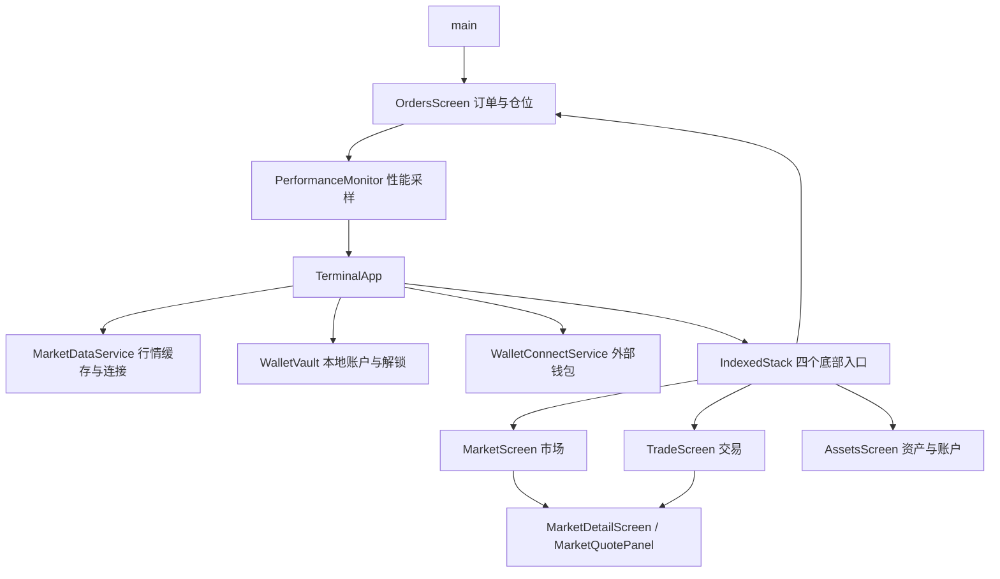
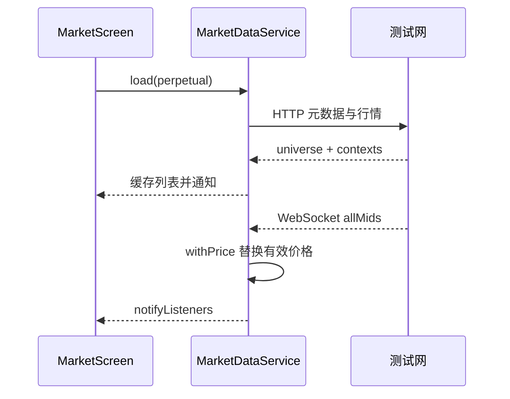
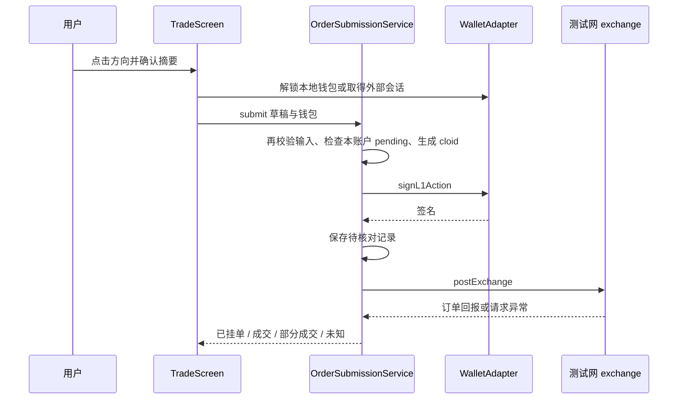
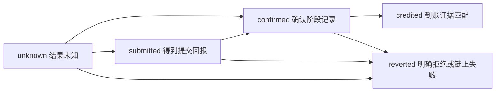

# 从零读懂 Hyperliquid Testnet Terminal App

这份指南带你在本地运行 App，并沿着一次“查看 BTC → 打开 K 线 → 填写订单 → 查看账户”的操作读懂代码。最后再学习钱包和资金流，知道哪些步骤只是读取，哪些步骤会签名或改变资产。

本文依据本仓库当前实现编写，核对日期为 **2026-11-05**。它不是交易操作建议，也不是 Web 功能已全部迁移的声明。示例中的价格、数量都是用于理解代码的假数据，练习不需要提交交易。

阅读顺序与完成标准：

1. [运行与目录](#一先把-app-跑起来)：能在 Android 打开四个入口。
2. [Dart 与组件](#二只学读这份代码需要的-dart)：能解释页面为什么会刷新。
3. [启动与状态](#三从-main-走到四个页面)：能画出服务和页面的归属。
4. [市场与推送](#四打开-btc-时行情怎样到达屏幕)：能追踪一次 HTTP 和一次 WebSocket 更新。
5. [图表](#五从一根蜡烛读懂整张-k-线)：能定位周期、手势、价格轴与实时线。
6. [订单](#六从表单到订单回报)：能区分确认、签名、已提交和未知回报。
7. [钱包与资产](#七钱包身份签名和资产展示)：能说清密钥存在哪里、余额来自哪里。
8. [资金](#八资金如何离开源账户又如何证明到账)：能说明存款、提款、内部划转的不同证据。
9. [测试与排查](#九测试调试与原生工程)：能独立定位一个页面问题而不发起交易。
10. [改一个小功能](#十自己完成一次小改动)：能按项目规则补注释、验证并解释变化。
11. [当前边界](#十一当前实现边界不要把未验证当作完成)：知道哪些能力还不能直接依赖。
12. [文件索引](#十二完整源码阅读索引)：回到每个模块继续读源码。

建议把每一阶段当成一次独立学习。刚接触 Dart 时，先完成前三阶段，再读异步行情；有 React/Vue 经验时，重点看 Widget 生命周期、控制器和设备插件，不必重复基础语法。达到阶段末的自查标准再继续，比一次读完所有文件更有效。

## 一、先把 App 跑起来

### 1. 认识仓库边界

这个目录是独立 App，旁边的 `hyperliquid-testnet-terminal` 才是 Web。App 直接通过 SDK 和 HTTP 访问测试网，没有额外自建后端，也没有邮箱登录。

先进入 App 根目录。后文命令未另行说明时都在这个目录执行：

```sh
cd /Users/julian/Documents/Codex/2026-11-02/hyperliquid-testnet-terminal-app
```

本轮本机已确认 Flutter **3.47.9 stable**、Dart **3.13.7**；这是核对时的环境快照，不代表未来最新版本。项目的 Dart 约束是 `^3.13.7`，具体依赖版本由 `pubspec.lock` 固定。Flutter 自带 Dart，先检查两个命令是否来自同一套工具链。

```sh
which flutter
which dart
flutter --version
dart --version
flutter doctor -v
```

预期看到工具版本和 Android 工具链状态。若 Dart 仍指向早期系统安装，应调整 PATH，让 Flutter 的 `bin` 优先；不要在未确认工具路径时升级项目依赖。`flutter doctor` 中的平台提示要结合目标判断，先跑 Android 不要求先解决 iOS 签名。

### 2. 安装依赖，启动 Android

```sh
flutter pub get
flutter emulators
```

第一条恢复 Dart 包，第二条列出已有模拟器。本机当前有 `hyperliquid_testnet_api36`。它未启动时执行：

```sh
flutter emulators --launch hyperliquid_testnet_api36
flutter devices
```

设备启动后，用 `flutter devices` 输出的 ID 运行。本机常用 ID 是 `emulator-5554`，多个模拟器同时运行时应替换成实际 ID：

```sh
flutter run -d emulator-5554
```

预期：进入市场页，可以切换市场、交易、订单与仓位、资产与账户；没有钱包也能只读浏览。钱包缺失应显示占位和连接入口，不应把未知余额显示成实际的零资产。

运行终端中 `r` 是热重载，保留多数 State；`R` 是热重启，会重新执行 Dart 启动流程。修改资源声明、插件或原生配置后通常需要停止并重新构建。热重载后状态仍旧，不一定说明代码未生效。

### 3. 先做一次只读巡检

依次打开 BTC 详情、切换 15 分与 1 小时、点图表选中后再点取消、拖动历史再回到最新、切换中英文、打开资产页。只观察布局和数据，不连接真实资金账户。

运行现有检查：

```sh
dart format --set-exit-if-changed lib test
flutter analyze
flutter test
```

第一条检查并可能整理格式；想主动统一格式可用 `dart format lib test`。分析器检查类型和规则，测试使用固定数据或替身。它们不证明真实设备签名或跨链到账成功。

若要安装提交检查工具：

```sh
npm ci
npm run check
```

这里的 Node 工具仅用于质量门禁，不负责运行 App。`package.json` 的 `check` 执行前面三个 Dart/Flutter 命令；Husky 的提交钩子先对暂存文件运行 `lint-staged`，再分析和测试。学习时不需要为触发钩子而提交代码。

**阶段自查**：能说明 `pubspec.yaml`、`pubspec.lock` 和 `package.json` 各管什么，能区分热重载与热重启，能在未连接钱包时浏览行情。

## 二、只学读这份代码需要的 Dart

先读 [market.dart](../lib/src/market/market.dart)。它比一个数百行页面更适合熟悉语言。

- `final` 表示变量只能赋值一次，并不自动让其中的 List 不可修改。`const` 表示编译时常量。
- `String?` 允许缺失，`??` 提供默认值，`?.` 在对象存在时访问。价格未知必须和 `0` 区分。
- `{required MarketTicker market}` 是命名参数，调用时写 `market: selected`，不用记一串参数顺序。
- `_price` 这样的下划线名字是库内私有。这里大多数 Dart 文件各自是一份库，其他文件不能直接调用它。
- `Future<T>` 是将来完成的一次结果；`await` 等待结果并把控制权交还事件循环。`Stream` 是多次事件，例如 WebSocket 状态变化。
- `withPrice` 返回新 `MarketTicker`，旧对象不修改。判断选中市场应该比较 `kind` 和 `coin`，不能只比较对象是否同一个。
- `({WalletRecord wallet, String mnemonic})` 是有命名字段的 record，用于新建钱包一次返回两个结果，不必新建包装类。
- `if (value case final x?)` 是模式匹配：非空时把值绑定给 `x`。先按“取非空值”理解，再深入语法。
- `try / catch / finally` 中 `finally` 即使出错也执行，适合恢复按钮状态；它不自动撤销已经发送的网络操作。

异步更新最重要的区别：`mounted` 只说明组件还在。用户可能已经从 BTC 切到 ETH，组件仍然在，因此还需要请求序号或币种检查，防止旧回包覆盖新页面。

读 [Flutter 官方学习路径](https://docs.flutter.dev/learn/pathway) 补组件、布局和状态基础；查具体语法用 [Dart 语言文档](https://dart.dev/language)。不必先学一整套第三方状态管理框架，本项目并未使用 Riverpod 或 Bloc。

**阶段自查**：用自己的话解释为什么 `price == null` 不能直接当作 `price == 0`，为什么一次 `await` 后除了 `mounted` 还可能需要其他检查。

## 三、从 main 走到四个页面

阅读顺序：[main.dart](../lib/main.dart) → [terminal_app.dart](../lib/src/app/terminal_app.dart) → [theme.dart](../lib/src/app/theme.dart)。

`main` 先建立 Flutter 与系统插件的绑定，恢复本地诊断、配置可选 Sentry，再注册性能采样并挂载 `TerminalApp`。根组件创建行情服务、钱包记录服务和外部钱包连接服务，通过构造参数交给页面。测试可以传入替身服务，跳过真实连接。



### 谁拥有状态

根组件保存当前底部页索引和语言；`MarketDataService` 保存跨页共用的市场列表；每个页面的 `State` 保存表单、选中周期、加载状态等。`WalletVault` 保存账户记录并通知监听者，页面再查询活跃账户。

`StatefulWidget` 是不可变配置，`State` 保存可变状态。`setState` 通知 Flutter 重新执行相关构建；`build` 描述当前状态应该长什么样，不应该在里面无条件发送网络请求。`ChangeNotifier.notifyListeners` 通知订阅它的组件重建或重新读取数据。可参考 [官方 ChangeNotifier 教程](https://docs.flutter.dev/data-and-backend/state-mgmt/simple)，但本项目使用构造参数传服务与 `ListenableBuilder`，不用照搬教程中的 Provider 层。

`IndexedStack` 让四个主页面保留 State。交易页另有 `active`：离开主交易入口时移除报价面板以释放订阅，表单仍保留。在交易页内部切换表单和图表时，图表一旦打开会通过 `Offstage` 保留内部滚动状态。这两种“切换”发生在不同层级。

### 生命周期与界面

`initState` 建立订阅和控制器；`dispose` 取消订阅、移除监听、释放控制器。App 进入 `inactive` 或 `paused` 时，根组件锁定本地钱包；下次本地签名重新认证。注意外部钱包切换会触发应用生命周期，但其签名由外部会话负责。

`_openWallets` 先选中资产底部入口，再压入钱包管理路由，所以返回后仍是资产页。详情买卖使用底部弹层，弹层把当前市场和买卖方向传入同一 `TradeScreen`。

主题集中定义深色、涨跌色和控件形状。输入框采用内部浮动标签，避免标签压在边框上；滚动行为关闭拉伸效果，避免 Android 边缘拖动时内容形变。布局基于 Flutter 的约束：父组件给可用尺寸，子组件决定自身尺寸，父组件定位子组件。遇到溢出时先看约束与 `Expanded/Flexible`，不要用缩放整个页面掩盖问题。

语言目前是根组件的 `_english` 布尔值，文案在页面中二选一；不是 ARB 本地化系统，也未保存语言偏好。部分服务错误和设备解锁提示仍是英文，见第十一章。

**阶段自查**：能指出“底部切页”“表单切 K 线”“从详情打开下单弹层”分别使用什么机制，以及谁负责释放图表订阅。

## 四、打开 BTC 时行情怎样到达屏幕

阅读 [market_data_service.dart](../lib/src/market/market_data_service.dart) 的 `load`、`connectRealtime` 和 `_updatePrices`，再看 [market_screen.dart](../lib/src/screens/market_screen.dart)。

### 一次查询与持续推送

首次选择永续，页面调用 `load(MarketKind.perpetual)`。服务请求元数据和行情上下文，生成 `MarketTicker` 列表并缓存，通知页面刷新。之后同类加载可直接使用缓存，主动刷新才绕过缓存。

WebSocket 是持续连接，不是每次刷新都重建。共享服务订阅 `allMids` 更新永续和 HIP-3 的价格，订阅 `spotAssetCtxs` 更新现货。HTTP 提供初始列表，推送替换其中的价格对象，页面订阅通知后重建。



列表搜索、排序发生在展示层。分类切换保留搜索词。作为选择器时，点击行通过 `pick` 返回市场；作为主市场页时，则打开详情。

### 四类市场为何不能共用一个数字序号

`coin` 是 API 标识，`displayName` 是展示名，`assetId` 是签名订单用的编号，三个概念不能混用：

- 永续 `assetId` 来自元数据 universe 原始位置；过滤下架币或重新排序不能改变它。
- HIP-3 保留 DEX 前缀，编号由 DEX 序号和其内部市场位置组合。当前公式是 `100000 + (dexIndex + 1) * 10000 + i`。
- 现货展示基础币/报价币，API 仍使用配对的原始名称，编号为 `10000 + pair.index`。
- 预测市场把 outcome 与方向编码成 `#编码`，订单编号在 `100000000` 上加编码，数量精度为整数。当前共享服务只装载元数据，未给预测列表补实时价格。

这些公式描述当前适配代码。更改协议映射前必须对照接口和 fixture，不能按 UI 行号生成订单编号。

### 不同位置的“价格”来源不同

列表与主交易标题使用市场 ticker；行情详情的大字价优先使用最新蜡烛收盘价；盘口中间可以展示买卖差价。这些值更新来源和口径不同，不能要求每帧完全相等。K 线实时虚线应跟随蜡烛收盘价，不应该随用户选择的历史蜡烛改变。

当前 `hasFreshPrice` 以市场类别记录 30 秒有效期，不是单币种时戳。顶部 `connected` 记录连接调用结果，也不是完整的持续连接健康判断。这些是理解当前行为时需要保留的边界。

### 订单簿、深度与图标

`MarketQuotePanel` 独立订阅当前币种的盘口、成交和蜡烛。`_acceptBook` 过滤旧盘口；`_acceptTrades` 按成交 ID 去重，按时间倒序保留最近 50 笔。各类数据分别保存失败状态，盘口失败不必抹掉已经加载的图表。

[book_view.dart](../lib/src/market/book_view.dart) 先过滤无效价格与数量，再把买价降序、卖价升序排列。累计量是基础币数量：两档分别挂 `0.1 BTC`、`0.2 BTC`，第二档累计为 `0.3 BTC`。深度图横轴是价格，纵轴是累计数量；它不是历史成交量。点击价格只回填表单，不提交订单。

[coin_icon.dart](../lib/src/market/coin_icon.dart) 优先使用随包安装的 BTC、ETH、SOL、HYPE 图标，其余尝试远程图标源。API 交易对名先转换成基础币名；预测市场及加载失败使用占位图形，固定尺寸避免跳动。

**阶段自查**：能解释为什么 ticker 对象被推送替换后，选中的 ETH 不能跳回 BTC；也能区分盘口挂单量与 K 线成交量。

## 五、从一根蜡烛读懂整张 K 线

阅读顺序：`MarketQuotePanel` 的订阅与 `_setBars` → [chart_candle.dart](../lib/src/chart/chart_candle.dart) → [terminal_chart.dart](../lib/src/chart/terminal_chart.dart) → [chart_period_bar.dart](../lib/src/chart/chart_period_bar.dart)。

### 1. 数据中的一根 K 线

蜡烛记录某周期的开盘、最高、最低、收盘（OHLC）、成交量、成交笔数和起始时间。以 15 分周期为例，10:00 到 10:15 内的多次推送更新同一个时间桶，只有下个周期才增加一根。

历史 HTTP 和推送都给累计成交量，不能相加。假设 HTTP 中这一根的量为 2，稍后推送为 3，正确结果是 3，不是 5。`newerCandle` 先比较成交笔数，再比较累计量；`mergeCandles` 按起始时间去重，按旧到新排序，最多保留 500 根。

`_loadCandles` 把 HTTP 快照与已收到的推送合并。`_loadSequence` 拦住迟到的旧查询；切周期时 `_periodChange` 还防止取消订阅期间另一次切换抢先完成。只判断 `mounted` 无法解决这两类竞态。

当前历史请求窗口约 300 个周期，并未实现向左无限分页补历史。月份仅在计算请求窗口长度时按 30 天估算。

### 2. 数据、指标与绘制分三层

`ChartCandle.fromCandles` 先计算指标，把原始 Candle 和指标字典放在同一个对象里。`ChartCandleAdapter` 实现图表库需要的接口。`TerminalChartDelegate` 负责坐标换算和绘制，不发起行情请求。

```text
HTTP / candle 推送
  → mergeCandles：去重、排序、保留新值
  → ChartCandle.fromCandles：计算指标
  → ChartCandleAdapter：交给 kline_flutter
  → TerminalChartDelegate：价格映射到像素、绘制与交互
```

用 MA5 理解预热期：收盘价依次为 100、101、102、103、104，第五根的均价是 102；前四根不足五个样本，值为 `null`，图层不把它当零连接。这里的 `double` 用于图形与指标；下单时的金额运算另用 `Decimal`。

主图指标与价格共用纵轴，副图指标有独立区域。当前提供 8 个主图、19 个副图选项，共 27 个。指标字典键必须等于 `series.id` 才能被适配器取出。选项齐全并不等于数值已逐个对齐 Web，KDJ 现有递推字段不一致详见第十一章。

### 3. 为什么会出现右侧遮挡或刻度不对

图中同时存在两种横坐标：内容坐标随蜡烛索引增长，视口坐标从屏幕左边开始。固定层使用 `centerX - scrollOffset`；滚动层由容器施加偏移，不能再减一次。

当前默认蜡烛宽 5.6、间隔 1.4 逻辑像素，主图高度为宽度的 0.94 倍并限在 230–420，副图为 0.285 倍并限在 76–118。右侧尾部空白参与滚动范围，真正绘制的裁剪则只扣实际价格轴宽度。这两个空间混用，就会在滚动后留下一条像“遮罩”的空白。

`_axisWidth` 测量当前价格文字。`getLayoutNodes` 从可见蜡烛、主图指标与最新价计算纵轴范围，刻度步长从 1、2、2.5、5、10 的数量级中选择。价格轴不是简单把小数位固定成两位；长价格也不能靠扩大固定空白来兜底。

`drawGrid` 在固定层绘制网格、轴文字和实时价。最新蜡烛可见时，价格虚线从该蜡烛延伸到右侧；向历史拖动使最新蜡烛不可见时，虚线从左边贯穿主图，价格仍由最新蜡烛更新。为让它可见，当前缩放范围也包含最新价，因此历史价格与当前差距很大时，历史波动会被压缩。

### 4. 手势、返回与周期选择

第一次点图表设置选择，第二次点清除；长按或在选中态拖动会移动选中点，普通横向拖动滚动历史。选择浮层使用 `IgnorePointer`，避免文字盒截获底下的图表手势。

`_setBars` 用时间保持选择与滚动锚点。新增蜡烛时，靠近末尾且未处于选择态才跟随最新；浏览历史时保持位置，避免每条推送都把用户拉回。

回到最新按钮先清除选择、恢复缩放为 1，再滚到 `itemCount - 1`。这里数据按时间升序，最新是最后一项；不能直接套用库中默认方向相反的“最新”索引假设。

默认周期为 `15m`。“分时”仍订阅 `1m`，仅切为收盘折线。更多周期弹层按四列显示，快捷周期用临时 `draft` 编辑，保存成功后才更新顶部；保存快捷项不会自行改变当前周期。只有这一偏好持久化在 `chart.quickIntervals`，手工线和多数图表状态只属于当前面板。

### 5. 账户线与手工线

[chart_overlay.dart](../lib/src/chart/chart_overlay.dart) 从账户仓位取开仓均价，从订单取委托价或触发价。触发且只减仓的订单标为保护线，其他币种会被过滤。`_walletSequence` 防止旧账户回包污染当前图表。

账户线是只读的；手工水平线可在弹层中添加、改价和删除。当前没有拖动账户线改单、趋势线工具或跨页面绘图存储，也没有账户订单实时流驱动每一次叠加线更新。

**阶段练习**：只改图表数据 fixture，给同一时间桶先送 3 笔再送 2 笔成交的蜡烛，验证后到的旧值没有覆盖新值。相关测试在 `chart_indicators_test.dart` 与 `widget_test.dart`。不要接真实交易来验证绘图。

## 六、从表单到订单回报

阅读 [trade_screen.dart](../lib/src/screens/trade_screen.dart) 的 `_reviewOrder`，再读 [order_safety.dart](../lib/src/trading/order_safety.dart) 和 [order_submission_service.dart](../lib/src/trading/order_submission_service.dart)。

### 表单首先只是本地草稿

数量、限价和触发价由 `TextEditingController` 保存；订单类型、只减仓、有效方式和滑点由页面 State 保存。切币会清除旧数量和触发价，移除新市场不支持的选项。点盘口价格只切回限价表单并填值。

输入框键盘类型不构成校验，粘贴内容可以绕开键盘。点击买入或卖出后，`_reviewOrder` 读取缓存中的当前市场，检查行情有效期、价格精度、数量精度、最低名义金额和触发方向，然后显示摘要。取消摘要时不拿签名适配器，也不发送请求。

以假设的 `BTC=80000 USDC`、`size=0.001 BTC` 为例，名义金额是 80 USDC。`Decimal` 保持十进制计算，送签名的价格和数量继续用字符串，避免二进制浮点把金额尾数改掉。数量的小数位来自市场元数据；价格同时受五位有效数字和 `(永续 6 / 现货 8) - sizeDecimals` 的小数上限约束。预测数量为整数、价格范围为 0.00001–0.99999；最低名义金额是预测 1、其他 10，`reduceOnly` 另有豁免规则。

市价模式实际生成 IOC 限价单：在保护价以内立即撮合，未成交部分撤销。`1 bps = 0.01%`，50 bps 就是 0.5%；80,000 的买入保护价在舍入前为 80,400，卖出为 79,600。最终按精度向更严格的方向取整，不无限放宽成交价格。

止损买单向上触发、止损卖单向下触发；止盈方向相反。触发价、委托限价和当前行情价各有用途，不要用一个输入值替代全部字段。

### 确认之后才开始签名和发送



`cloid` 是客户端生成的 128 位订单标识。它随订单发送，未知时用同一标识查询。`nonce` 是本次动作的毫秒时间值，用于签名协议。订单使用 SDK 的 `signL1Action`，资金操作还有其他签名类型，不能互相替换。

当前顺序是**先签名，再保存 pending，再发 HTTP**。因此用户拒签不会留下订单 pending；一旦准备发送，则必须先保存，因为超时可能发生在服务端已经接受订单之后。

`buildOrderAction` 生成协议字段：订单数组内含资产、方向、价格、数量、订单类型和 `c`（cloid），外层 `grouping` 为独立订单。离线测试检查这些字段；它不是对实际钱包签名做了逐字节交叉验收。

### 回报不明不等于失败

明确拒绝、已挂单、成交和部分成交会移除本地 pending；未知结构的成功响应或网络异常保留它。下次提交前发现同账户仍有 pending，会要求先核对。

`reconcile` 只请求 `orderStatus(user, oid=cloid)`。查询找到订单时解除记录；超过 30 秒且仍返回 `unknownOid` 时按现有规则解除；其他情况继续等待。整个核对过程不自动创建第二笔订单。

[orders_screen.dart](../lib/src/screens/orders_screen.dart) 查询仓位、挂单、成交与本地 pending。撤单另走用户确认 → 查对应 `assetId` → 当前钱包调用 `ExchangeClient.cancelOrders`。目前仓位列表主要用于展示，不代表完整的平仓、杠杆和保护单编辑能力。

现有表单检查还没有覆盖完整账户余额、保证金和仓位预检查，也未在用户确认耗时之后再次检查行情有效期。页面 `_working` 只约束当前页面，并非所有实例共享的互斥锁；阅读时不能把它理解成系统级严格幂等保证。

**阶段自查**：能解释“钱包拒签”和“提交后超时”为何必须采用不同处理；能找到待核对记录的保存点，而不是只找到提交按钮。

## 七、钱包身份、签名和资产展示

### 本地钱包：记录与秘密分开

阅读 [wallet_vault.dart](../lib/src/wallet/wallet_vault.dart) 和 [key_derivation.dart](../lib/src/wallet/key_derivation.dart)。

创建时生成 12 个英文助记词，用 BIP-39 得到 seed，再沿 `m/44'/60'/0'/0/0` 推导第一个以太坊账户。助记词导入走相同派生路径；私钥导入直接恢复地址。助记词在创建返回值中交给备份弹层，持久化保存的是推导后的私钥，不保存一份可重新打开的助记词。

`WalletRecord` 只包含 ID、名称、地址、种类。`wallets.v1` 保存记录列表，`wallets.active` 保存当前 ID，`wallet.secret.<id>` 保存本地私钥，均由 `FlutterSecureStorage` 处理。图表偏好和有界的脱敏诊断摘要放 `SharedPreferences`。这是两个用途不同的存储层，不能为方便调试把私钥搬到偏好或日志中。

可以保存多个账户，但只有一个活跃账户。切换会清空已解锁适配器；地址相同的本地导入会拒绝重复。私钥、元数据与活跃 ID 分多次写入，并不是一个数据库事务，不能推断所有写入失败都自动回滚。

本地会话第一次需要签名时，`unlockActive` 请求设备认证，之后缓存 `_LocalWalletAdapter`。锁定清空缓存并释放链上客户端；这不等于 Dart 主动把所有私钥字符串内存逐字节抹除。删除钱包只删除本机记录与密钥，不能删除链上账户或撤销已经签出的交易。

### 外部钱包：同一接口，不同签名位置

SDK 的 `WalletAdapter` 统一 `getAddress` 和 `signTypedData`。本地实现使用 SDK 私钥适配器；[wallet_connect_service.dart](../lib/src/wallet/wallet_connect_service.dart) 的 Reown 实现把请求发送给外部钱包，App 获取结果，不持有它的主私钥。

CCTP 存款还需要发 EVM 交易，因此 [evm_transaction_wallet.dart](../lib/src/wallet/evm_transaction_wallet.dart) 补充切链和发送交易接口。本地实现仅允许 Arbitrum Sepolia；外部实现请求切链后再查询 `eth_chainId`，不能把切链请求被接受当作已经切换完成。

保存一个外部地址不等于恢复可用会话。只有 Reown 已连接且 session 有效时，才能取得签名适配器。Project ID 用 `String.fromEnvironment` 从构建参数读取，普通 shell 环境变量不会自动生效：

```sh
flutter run -d emulator-5554 --dart-define=REOWN_PROJECT_ID=替换为本机项目ID
```

本轮没有执行外部钱包连接。Project ID 也不是唯一前置条件：原生深链、应用 metadata、设备认证配置仍有待补齐项，见第十一章。

### 资产数值分别从哪里来

[assets_screen.dart](../lib/src/screens/assets_screen.dart) 的 `_refresh` 读取交易所的账户历史、现货余额和永续状态。总资产用月度账户历史最后一个 USD 估值；月盈亏用区间盈亏变化；现货币数量与永续权益分别展示，不把不同代币的数量直接相加。

`_refreshId` 阻止旧账户请求覆盖新账户，切换账户先清空旧显示。查询失败或没连接钱包保留未知状态，不伪造零余额。眼睛按钮只改变展示，不改变数据和权限。

资产总览、钱包管理、资金待核验记录复用 `AssetsScreen`，由 `AssetPage` 区分入口。`_run` 负责串行化当前页操作、展示错误、在 `finally` 中恢复按钮；具体金额检查和状态保存仍在资金 service 中。

**阶段自查**：能区分“钱包地址记录”“可用签名会话”“链上资产”，并说清切换账户时有哪些本地状态需要作废。

## 八、资金如何离开源账户，又如何证明到账

先读 [funding_transfer_service.dart](../lib/src/funding/funding_transfer_service.dart) 理解简单划转，再读 [funding_bridge_service.dart](../lib/src/funding/funding_bridge_service.dart)。以下是代码流程说明，不是让你实际执行转账。

### 先分清三个编号和两种金额

USDC 使用 6 位最小单位，`12.34 USDC` 编码为 `12340000`；代码用 `BigInt`。源链 Gas 余额是 ETH 的 wei，1 ETH 为 10^18 wei。UI 的字符串、`Decimal` 金额和链上整数各有边界，不要来回经 `double` 转换。

EVM `chainId` 标识链，CCTP `domain` 是桥协议的编号，EIP-712 签名域又是签名内容的一部分。这里源链 Arbitrum Sepolia 的 chainId 为 421614，CCTP 源 domain 为 3、目标 Hyperliquid domain 为 19。提款 action 的签名域 chainId 为 42161，并不因此变成主网发送；实际还由 `hyperliquidChain: Testnet` 和测试网 transport 指定环境。不要看到不同编号就统一替换。

### 1. 现货与永续内部划转

例如将 12.34 USDC 从现货划到永续：页面收集方向和金额并确认，service 重新查询账户状态。现货可用量取 `total - hold` 且不小于零；反方向取永续 `withdrawable`。金额超过源可用余额会在签名前拒绝。

服务构造 `usdClassTransfer`，`toPerp=true` 表示现货转永续。使用 user-signed action 签名后，发送前保存 pending。明确成功或拒绝移除记录；网络未知保留。此处没有订单 cloid 查询，人工查看两侧余额后才能解除本地记录，解除本身不发送新划转。

### 2. 从 Arbitrum Sepolia 存款

资产页先只读查询 USDC 余额、授权额度 allowance 和 ETH Gas 余额。用户确认后，`submitDeposit` 核对钱包地址、已有 pending 和目标链，再重读余额。

若授权不足，先模拟 `approve`（允许指定合约使用本次额度），保存 unknown，再请求钱包发送授权交易。取得哈希后记录 submitted，最多等待两分钟的源链回执。成功后重新确认授权量及活跃钱包，再模拟并发送带 hook 的 CCTP 存款调用。

`eth_call` 模拟不改链上状态。它通过也不代表后续真实交易一定成功。实际调用需要钱包签名和网络确认。

Hook 告诉桥目标接收规则，内部编码采用 `bytes24 + uint32 + uint32 + address + uint32`，其中 uint32 占 4 字节；外层 ABI 动态 bytes 才按 32 字节补齐。把内部字段都补成 32 字节会改变消息，这正是离线测试要保护的内容。

存款的完成证据不是一个哈希：先确认源链回执成功，再用跨链索引匹配源哈希和链得到 nonce，最后在 Hyperliquid 的 `userNonFundingLedgerUpdates` 中匹配 nonce、接收地址和 USDC 账本记录，才标为 credited。

### 3. 从 Hyperliquid 提款

`withdrawalQuote` 并发只读查询账户模式、永续和现货余额、HYPE Gas、路由及激活费。统一或组合保证金模式读取现货相关可用量，并考虑维护保证金限制；其他模式使用永续可提余额。Gas 当前按实现中的估算量和价格计算，能用 HYPE 支付则用 HYPE，否则估算 USDC，另计激活费。

页面展示快照，用户确认后 `submitWithdrawal` 再获取新快照。账户不一致、来源账户改变、费用升高或 Gas 币种改变，都要求重新确认。它在签名前保存 unknown，签名后再次检查活跃钱包，再提交 `sendToEvmWithData`；明确拒绝标 reverted，其他异常保持待核验。

当前实现还按固定 0.2 USDC 处理目标侧费用。示例 `0.4 USDC` 提款对应最低 `0.2 USDC` 净到账匹配；这是代码假设，不能把它当作永远不变的链上报价。

核验时先按本次 nonce 和目标 domain 查跨链索引，取得目标交易哈希，再查询 Arbitrum Sepolia 回执中的 USDC `Transfer` 日志，确认接收者和扣费后金额。拿到交易哈希仍不等于核验完成。

### 4. 状态与人工核对



这是便于阅读的状态关系，不保证每种操作都经过每个节点。授权只需源链 confirmed；存款和提款在 confirmed 后仍属于待核验。提款代码会在索引找到哈希时先保存 confirmed，之后还查回执，因此不能单凭状态名推断目标链最终性。

`reconcile` 只读查询证据，不重新签名发送。页面提供手动核验，不是后台持续自动到账监控。证据不足保持原状态；网络失败不把 unknown 随意改成 reverted。

“人工核对后解除”只删除本地限制，既不撤销链上交易，也不证明之前没有成功。存款、提款、内部划转各用自己的记录，不能拿订单 cloid 的处理规则直接套过来。

**阶段自查**：用 12.34 USDC 举例，分别说出内部划转、存款、提款是谁签什么、资产从哪里到哪里、需要什么到账证据，以及超时后留下什么。

## 九、测试、调试与原生工程

### 先知道每类测试证明什么

- `market_test.dart`：涨跌幅与缺失价格处理。
- `chart_indicators_test.dart`：蜡烛合并、指标选项、部分均线样例；没有覆盖全部指标公式。
- `chart_overlay_test.dart`：账户价格线的币种筛选和分类。
- `order_safety_test.dart`：精度、最低金额、订单 wire 字段；不向交易所提交。
- `key_derivation_test.dart`：公开测试向量的密钥派生结果；测试密钥不能装资产。
- `funding_transfer_test.dart`：划转金额与协议字段。
- `funding_bridge_test.dart`：CCTP 编码、提款 typed data、金额边界、到账匹配和账户一致性辅助检查。
- `widget_test.dart`：替身服务驱动导航、图表合并/滚动/点击、双语输入框、订单确认方向等交互。

只跑相关测试可以缩短排查周期：

```sh
flutter test test/chart_indicators_test.dart test/chart_overlay_test.dart
flutter test test/widget_test.dart
flutter test test/order_safety_test.dart test/funding_transfer_test.dart test/funding_bridge_test.dart
```

组件测试固定屏幕尺寸、主动推送数据；没有真实设备认证和外部钱包。测试类型可对照 [Flutter 官方测试说明](https://docs.flutter.dev/testing/overview)。本仓库当前没有覆盖整条真实签名/资金路径的集成测试。

### 日志、异常与性能入口

当前启动链为 `main → initializeMonitoring → PerformanceMonitor.start → runApp`。监控先恢复最近摘要；未设置 DSN 就不启动云端采集。原本的共享行情、钱包和交易流程继续由 `TerminalApp` 管理。

点首页“实时 / 离线”状态可进入诊断面板。按 requestId 找一次接口，按 traceId 找一次操作；本地记录上限 200 条，最近最多 60 条摘要落盘，总大小约 64 KB。私钥与原始异常消息不能写入诊断。新增模块为 `lib/src/diagnostics/`，测试为 `test/diagnostics_test.dart`。完整操作与 Sentry 免费额度说明见 [排障与监控指南](monitoring.md)。

K 线快照与推送现在先做有限数、OHLC、时间和成交量检查，拒收的原因进入诊断。图表指标计算仍沿用原算法，仅添加 Timeline 计时；不可把新增监控当成算法正确性证明。

### 按问题所在层排查

- 列表没数据：先看 `load` 的类别缓存、error 和 loading，再看 HTTP；不要先改布局。
- 换币后回跳：看 `kind/coin` 比较、异步返回时的请求序号，不只看 Widget 是否 mounted。
- K 线不更新：看订阅的 coin/interval、桶起始时间和 `newerCandle`，再看 `_setBars` 是否更新控制器。
- 横向遮挡：核对内容坐标与视口坐标、裁剪和价格轴测量，避免用背景块遮盖画错的部分。
- 切回图表为空：看图表挂载、控制器滚动位置和 `Offstage`，不要靠用户再次点击触发刷新。
- 金额校验报错：先找 `Decimal` 输入与元数据的小数上限，显示格式并不等于签名格式。
- 资金结果未知：先看已保存的 nonce、状态和核验分支，不能通过“再发一次”排查。

可以在 IDE 给 `_applyCandle`、`_setBars`、`_reviewOrder` 和 `reconcile` 设断点。查看必要的币种、周期、计数与状态即可，避免展开或记录私钥、助记词、完整签名和连接凭据。

### Android / iOS 目录不是另一套页面

Android 的 `MainActivity.kt` 和 iOS 的 `AppDelegate.swift`、`SceneDelegate.swift` 是 Flutter 宿主与插件入口。实际 UI 在 Dart。`AndroidManifest.xml` 与 `Info.plist` 管权限、链接与启动场景，修改 Dart 不能替代这些配置。

`android/app/build.gradle.kts` 读取 Flutter 的 SDK 和版本号，Java/Kotlin 目标为 17；`android/build.gradle.kts` 包含 Coinbase 依赖的兼容覆盖。不要手改 `.pub-cache` 或生成的插件注册代码来修复仓库问题。

本机可进行构建检查，命令如下；**本次注释与文档任务没有重新执行这两项构建**：

```sh
flutter build apk --debug
flutter build ios --no-codesign
```

iOS `--no-codesign` 不能证明真机可安装签名正确。当前 Android release 仍使用 debug 签名，也不能把成功产出的 APK 直接视为可发布版本。具体配置缺口见下一章边界。

**阶段自查**：能给一个 UI 问题选对测试文件，说明单元测试、组件测试与真实设备验收各自覆盖了什么。

## 十、自己完成一次小改动

练习选择“市场列表增加绝对价格变化”，只读、无新依赖，也不碰签名。以下只是练习指引，本轮没有增加这个功能。

先在 `market.dart` 看现有涨跌幅计算，再设计一个计算值：有当前价格和有效前日价格时返回差值，否则返回 `null`。例如当前 101、前日 100 返回 1；缺少前日价格返回 null。然后在 `_MarketRow` 使用它，格式化仍放展示层，不能改 `coin` 或 `assetId`。

按这个顺序做：

1. 在 `market_test.dart` 添加正常值和缺失值的行为测试，确认新行为目前还不存在。
2. 在模型中实现最小计算，补中文 `///`，说明输入缺失为什么保留 null。
3. 在列表显示新字段，同时处理窄屏、中英文和占位，不新增自己的颜色体系。
4. 修改这份学习文档的市场章节，说明数据来源、刷新方式和缺失值行为。
5. 运行相关测试、格式检查和分析，再在 Android 观察一次真实只读行情。
6. 检查差异，只交付本功能范围，不夹带更换状态管理或修改钱包。

注释应解释业务契约。例如现有蜡烛合并函数可以这样描述：

```dart
/// 按周期起始时间合并历史快照与推送，保留较新的累计数据。
/// 返回结果按时间升序排列，最多保留最近 500 根；不会累加同桶成交量。
```

这段用于示范现有 `mergeCandles` 声明前的文档注释，不需要另建一个同名函数。简单赋值无需逐行写“设置变量”，需要解释的是为什么不累加成交量、为什么只保留 500 根。

后续开发约定在 [AGENTS.md](../AGENTS.md)。新增功能时文件职责、公共 API、状态边界、单位和失败行为都要同步说明。这是工程约定，分析器无法自动证明说明真实完整。

检查当前改动：

```sh
git status --short
git diff -- lib/src/market/market.dart lib/src/screens/market_screen.dart test/market_test.dart docs/learning-path.md
```

本仓库核对时还没有首个提交，源码属于 untracked，普通 `git diff` 不展示未跟踪文件内容。因此需要保留修改前副本并对照；不要为了看到差异擅自 `git add` 或提交。后续由用户建立版本基线后，常规 diff 才能完整反映修改。

## 十一、当前实现边界：不要把未验证当作完成

以下是本轮阅读源码发现的事实，不是本轮已经修好的功能。实际行为仍以对应实现与测试为准。

1. **App 尚未与 Web 完全等价。** 阶梯、TWAP、追价、移动止损、附带 TP/SL、杠杆调整，以及完整仓位管理未全部实现。API 钱包批准/代理签名也没有独立适配流程。
2. **四类市场的数据覆盖不同。** 预测列表目前主要是元数据，价格为空；共享服务没有为它建立与永续相同的实时价格更新。不能把“有分类入口”写成四类已完整实测。
3. **27 个指标是选项覆盖。** `ChartCandle.fromCandles` 中 KDJ 上一值读取 `kdjK/kdjD`，而结果保存为 `k/d`，会回退到默认值。这是现有数值缺陷，尚未在本轮改动；其余指标也没有完成全部 Web 结果对照。
4. **订单保护还有缺口。** 当前没有通用的账户余额/保证金/仓位预检查；行情有效期按类别计算，确认弹层之后也没有再次核验时效。pending 读写与页面忙碌标志不是跨实例原子锁。
5. **外部钱包还需原生联调。** Reown metadata 的站点仍是示例值；Dart 中声明了 `hyperliquidterminal://`，Android/iOS 尚未注册对应返回链接。Android 的 MainActivity 当前继承 FlutterActivity，设备认证宿主兼容性需按已安装插件要求核对；iOS 尚缺 `NSFaceIDUsageDescription`。不能认为配置 Project ID 后全流程已完成。
6. **发布配置未完成。** Android 主 Manifest 未显式声明 INTERNET，debug/profile 清单有该权限；release 合并清单中的最终网络权限尚未核验，且仍使用 debug 签名。仅在调试模拟器能访问行情，不能证明 release 可用。
7. **多语言覆盖不完整。** 页面有中英文切换，但语言不持久化，若直接显示底层异常仍会出现英文，设备认证原因也为英文。
8. **图表与账户线有生命周期限制。** 图表只保留有限历史，水平线不跨页保存，账户线不是订单 WebSocket 实时同步结果，不能拖动改单。
9. **资金测试主要是离线校验。** 协议常量、路由、固定目标侧费用、外部钱包交互和到账行为仍需按实际测试设备与测试网重新验收。安全存储的多次写入也非事务；不要从测试通过推断任何异常都能完整回滚。

学习时先把这些边界讲清楚，再逐项修正和补验证。不要通过修改说明文字把未完成项变成“已支持”。

## 十二、完整源码阅读索引

下面列出全部业务 Dart 文件，便于从一个界面返回具体实现。每个文件顶部已有中文职责说明，关键方法附近说明状态、单位或失败处理。

**入口与主题**

- [main.dart](../lib/main.dart)：建立平台绑定并启动根组件。
- [terminal_app.dart](../lib/src/app/terminal_app.dart)：共享服务、导航、语言和应用生命周期。
- [theme.dart](../lib/src/app/theme.dart)：颜色、文本和控件基础样式。

**诊断与监控**

- [app_diagnostics.dart](../lib/src/diagnostics/app_diagnostics.dart)：脱敏、有界记录、摘要持久化与操作关联。
- [diagnostic_http_client.dart](../lib/src/diagnostics/diagnostic_http_client.dart)：接口观察与 SDK transport 接入。
- [sentry_monitoring.dart](../lib/src/diagnostics/sentry_monitoring.dart)：全局错误捕获、云端字段过滤与预算。
- [performance_monitor.dart](../lib/src/diagnostics/performance_monitor.dart)：帧、进程内存与十秒计数。
- [diagnostics_screen.dart](../lib/src/diagnostics/diagnostics_screen.dart)：本地查看、筛选与报告复制。

**市场与盘口**

- [market.dart](../lib/src/market/market.dart)：四类市场统一模型与显示计算。
- [market_data_service.dart](../lib/src/market/market_data_service.dart)：缓存、元数据、共享行情连接、历史蜡烛查询。
- [book_view.dart](../lib/src/market/book_view.dart)：盘口排序、累计量、深度绘制与价格回填。
- [coin_icon.dart](../lib/src/market/coin_icon.dart)：本地和远程图标及占位。

**图表**

- [chart_candle.dart](../lib/src/chart/chart_candle.dart)：快照合并、技术指标和 KLineDataAdapter。
- [terminal_chart.dart](../lib/src/chart/terminal_chart.dart)：比例、价格轴、绘制、点击和回到最新。
- [chart_period_bar.dart](../lib/src/chart/chart_period_bar.dart)：周期弹层与快捷偏好。
- [chart_overlay.dart](../lib/src/chart/chart_overlay.dart)：仓位、委托与保护线转换。

**订单**

- [order_safety.dart](../lib/src/trading/order_safety.dart)：输入精度、金额和滑点保护。
- [order_submission_service.dart](../lib/src/trading/order_submission_service.dart)：构造、签名、持久化和 cloid 核对。

**钱包**

- [wallet_vault.dart](../lib/src/wallet/wallet_vault.dart)：账户记录、安全存储、会话解锁与本地签名。
- [key_derivation.dart](../lib/src/wallet/key_derivation.dart)：固定路径密钥派生。
- [wallet_connect_service.dart](../lib/src/wallet/wallet_connect_service.dart)：Reown 外部会话和 JSON-RPC。
- [evm_transaction_wallet.dart](../lib/src/wallet/evm_transaction_wallet.dart)：链上交易和资源释放接口。

**资金**

- [funding_transfer_service.dart](../lib/src/funding/funding_transfer_service.dart)：现货/永续内部划转。
- [funding_bridge_service.dart](../lib/src/funding/funding_bridge_service.dart)：CCTP 存提款、编码、费用和到账核验。

**页面**

- [market_screen.dart](../lib/src/screens/market_screen.dart)：市场分类、搜索、排序与选择。
- [market_detail_screen.dart](../lib/src/screens/market_detail_screen.dart)：独立详情和共用 MarketQuotePanel。
- [trade_screen.dart](../lib/src/screens/trade_screen.dart)：表单、买卖方向和确认流程。
- [orders_screen.dart](../lib/src/screens/orders_screen.dart)：账户、仓位、订单、成交和撤单。
- [assets_screen.dart](../lib/src/screens/assets_screen.dart)：资产展示、钱包管理和资金操作入口。

## 本轮验证记录

本节记录的是注释与学习文档任务的检查，不代替功能验收。核对结果如下：

- `dart format --output=none --set-exit-if-changed lib test`：32 个文件，0 个需要改动。
- `flutter analyze`：No issues found。
- `flutter test`：39 个测试全部通过。
- 用 Dart analyzer 解析修改前备份与当前源码：24 个业务文件、8 个测试文件的非注释 token 完全一致。
- `pubspec.yaml` 与 `analysis_options.yaml` 解析后的值一致；11 个原生/钩子文件的非注释内容一致。
- `plutil -lint ios/Runner/Info.plist`、`ruby -c ios/Podfile`、`sh -n .husky/pre-commit`：通过语法检查。这里没有执行一次真实 Git 提交。
- README、学习路径和项目规则中的 63 个本地文件链接/章节锚点均有效。

验证脚本是本次本地审阅工具，没有加入项目依赖或提交门禁。本轮未重新构建或安装 Android/iOS，也没有执行真实钱包签名、交易、转账或到账验收；第十一章列出的已知问题仍然存在。
